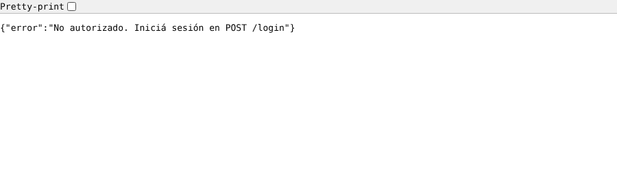
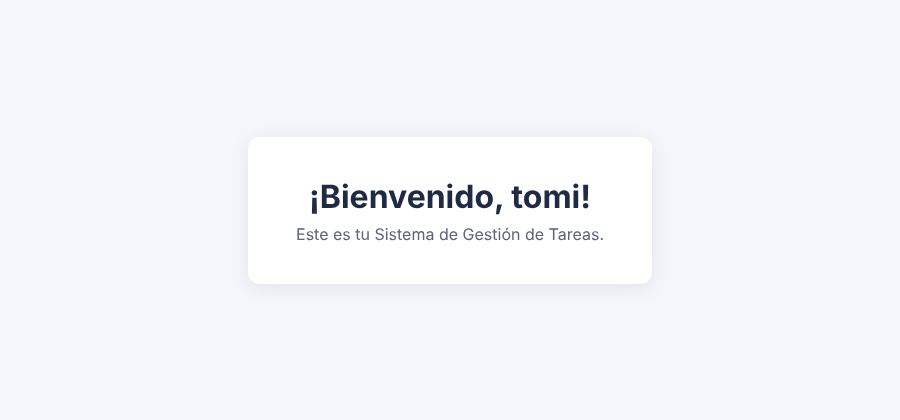
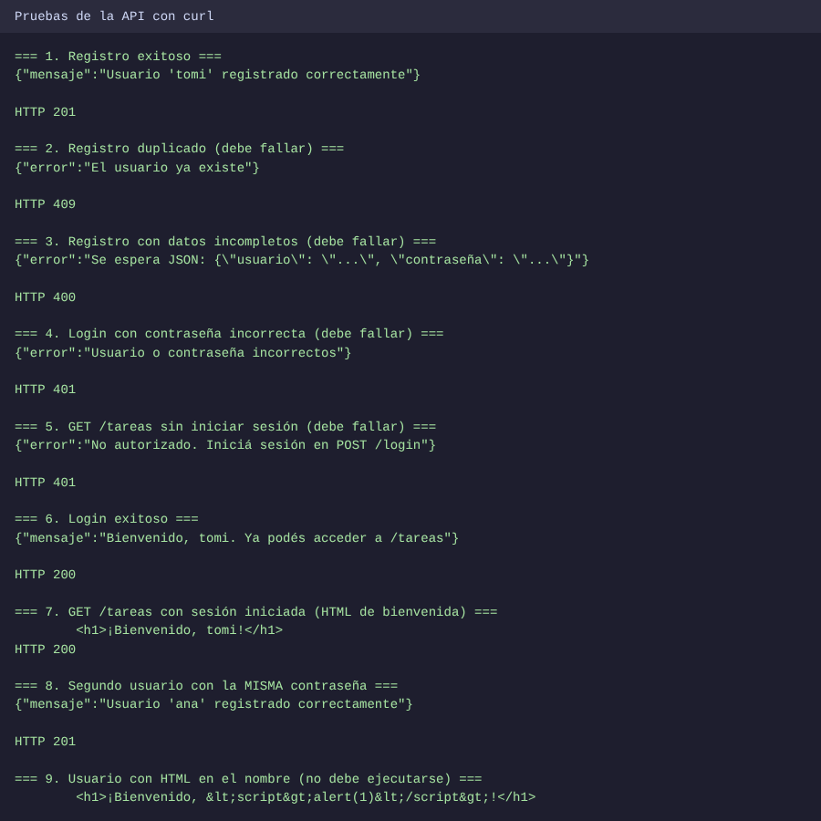
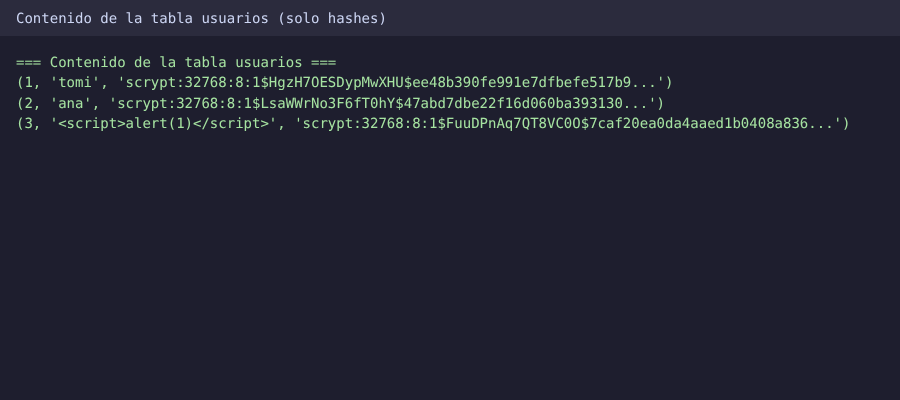

# PFO 2: Sistema de Gestión de Tareas con API y Base de Datos

API REST hecha con **Flask** que permite registrar usuarios, iniciar sesión y acceder a una página de bienvenida protegida. Los datos se guardan en **SQLite** y las contraseñas se almacenan **hasheadas**, nunca en texto plano.

## Contenido

- [Estructura del proyecto](#estructura-del-proyecto)
- [Requisitos e instalación](#requisitos-e-instalación)
- [Cómo ejecutarlo](#cómo-ejecutarlo)
- [Endpoints](#endpoints)
- [Cómo probarlo](#cómo-probarlo)
- [Capturas de pruebas exitosas](#capturas-de-pruebas-exitosas)
- [Base de datos](#base-de-datos)
- [Decisiones de seguridad](#decisiones-de-seguridad)
- [GitHub Pages](#github-pages)
- [Respuestas conceptuales](#respuestas-conceptuales)

## Estructura del proyecto

```
.
├── servidor.py          # API Flask + SQLite
├── cliente.py           # Cliente de consola (opcional) que consume la API
├── requirements.txt     # Dependencias
├── README.md
└── docs/                # Sitio publicado con GitHub Pages
    ├── index.html       # Documentación del proyecto
    └── capturas/        # Capturas y salida de las pruebas
```

`tareas.db` se crea automáticamente la primera vez que se ejecuta el servidor.

## Requisitos e instalación

- Python 3.9 o superior

```bash
# (Opcional pero recomendado) entorno virtual
python3 -m venv venv
source venv/bin/activate        # En Windows: venv\Scripts\activate

# Instalar dependencias
pip install -r requirements.txt
```

El hasheo de contraseñas usa `werkzeug.security`, que ya viene incluido con Flask, así que no hace falta instalar nada más.

## Cómo ejecutarlo

```bash
python3 servidor.py
```

El servidor queda escuchando en **http://127.0.0.1:5000**. Para detenerlo: `Ctrl + C`.

## Endpoints

| Método | Ruta        | Cuerpo (JSON)                                  | Descripción                                             | Respuestas                  |
|--------|-------------|------------------------------------------------|---------------------------------------------------------|-----------------------------|
| POST   | `/registro` | `{"usuario": "nombre", "contraseña": "1234"}`  | Registra un usuario con la contraseña hasheada          | `201`, `400`, `409`         |
| POST   | `/login`    | `{"usuario": "nombre", "contraseña": "1234"}`  | Verifica credenciales e inicia sesión                   | `200`, `400`, `401`         |
| GET    | `/tareas`   | —                                              | Devuelve un HTML de bienvenida (requiere sesión)        | `200`, `401`                |

Códigos usados: `201` creado, `200` correcto, `400` datos inválidos o incompletos, `401` no autorizado, `409` el usuario ya existe.

## Cómo probarlo

Con el servidor corriendo, abrí **otra terminal**.

### Opción 1: curl (Linux / macOS / Git Bash)

```bash
# 1. Registrar un usuario
curl -X POST http://127.0.0.1:5000/registro \
  -H "Content-Type: application/json" \
  -d '{"usuario": "tomi", "contraseña": "1234"}'

# 2. Iniciar sesión (-c guarda la cookie de sesión en cookies.txt)
curl -c cookies.txt -X POST http://127.0.0.1:5000/login \
  -H "Content-Type: application/json" \
  -d '{"usuario": "tomi", "contraseña": "1234"}'

# 3. Acceder a /tareas usando la cookie (-b la envía)
curl -b cookies.txt http://127.0.0.1:5000/tareas

# 4. Sin la cookie debe responder 401
curl -i http://127.0.0.1:5000/tareas
```

### Opción 2: Postman o Thunder Client (cualquier sistema)

1. `POST http://127.0.0.1:5000/registro` con Body → raw → JSON: `{"usuario": "tomi", "contraseña": "1234"}`
2. `POST http://127.0.0.1:5000/login` con el mismo JSON. Postman guarda la cookie de sesión automáticamente.
3. `GET http://127.0.0.1:5000/tareas` debería mostrar el HTML de bienvenida.

### Opción 3: Python (sirve en Windows sin pelearse con las comillas)

```bash
pip install requests
```

```python
import requests

s = requests.Session()  # la Session conserva la cookie entre llamadas
cred = {"usuario": "tomi", "contraseña": "1234"}

print(s.post("http://127.0.0.1:5000/registro", json=cred).json())
print(s.post("http://127.0.0.1:5000/login", json=cred).json())
print(s.get("http://127.0.0.1:5000/tareas").text)
```

### Ver `/tareas` en el navegador

La sesión vive en una cookie, y el navegador solo la tiene si inició sesión *desde el propio navegador*. Para eso, abrí `http://127.0.0.1:5000/tareas`, abrí la consola de las herramientas de desarrollo (F12) y ejecutá:

```javascript
fetch("/login", {
  method: "POST",
  headers: {"Content-Type": "application/json"},
  body: JSON.stringify({usuario: "tomi", contraseña: "1234"})
}).then(r => r.json()).then(console.log)
```

Después recargá la página y aparece el HTML de bienvenida (el usuario `tomi` tiene que estar registrado antes).

## Capturas de pruebas exitosas

**`GET /tareas` sin sesión: acceso denegado (401)**



**`GET /tareas` con sesión iniciada: HTML de bienvenida**



**Pruebas de todos los endpoints (éxito y errores)**



**Contenido de la base de datos: solo hashes, ninguna contraseña en texto plano**



La salida completa de las pruebas en texto está en [`docs/capturas/pruebas.txt`](docs/capturas/pruebas.txt).

## Base de datos

Archivo `tareas.db` (SQLite), tabla `usuarios`:

| Campo           | Tipo    | Descripción                                          |
|-----------------|---------|------------------------------------------------------|
| `id`            | INTEGER | Clave primaria autoincremental                       |
| `usuario`       | TEXT    | Nombre de usuario, **único** (`UNIQUE`)              |
| `password_hash` | TEXT    | Hash de la contraseña (algoritmo, sal y resultado)   |

Para inspeccionarla:

```bash
sqlite3 tareas.db "SELECT id, usuario, password_hash FROM usuarios;"
```

## Decisiones de seguridad

- **Contraseñas hasheadas** con `generate_password_hash` (scrypt con sal aleatoria por usuario) y verificadas con `check_password_hash`. Dos usuarios con la misma contraseña obtienen hashes distintos.
- **Consultas parametrizadas** (`?`) en todas las operaciones SQL, lo que evita inyección SQL.
- **Mensaje de error genérico en el login:** responde igual si el usuario no existe o si la contraseña es incorrecta, para no revelar qué usuarios están registrados.
- **Escape de HTML** en `/tareas`: el nombre de usuario se escapa antes de mostrarse, así que un usuario llamado `<script>...` no se ejecuta en el navegador.
- **Sesión con cookie firmada** (`session` de Flask). La clave de firma se toma de la variable de entorno `SECRET_KEY`; si no está definida se usa un valor de desarrollo.

```bash
# Ejemplo: definir una clave propia antes de ejecutar
export SECRET_KEY="una-clave-larga-y-aleatoria"      # Windows (PowerShell): $env:SECRET_KEY="..."
python3 servidor.py
```

> Alcance: es un trabajo práctico. En un sistema real habría que servir por HTTPS, limitar los intentos de login y no dejar la clave por defecto.

## GitHub Pages

GitHub Pages solo publica **sitios estáticos** (HTML, CSS, JS) y no puede ejecutar Python ni Flask. Por eso, la carpeta `docs/` contiene una página con la documentación del proyecto, las capturas y las respuestas conceptuales, y es la que se publica. **La API en sí se ejecuta de forma local** siguiendo los pasos de arriba.

Para activarlo en tu repositorio:

1. En GitHub, andá a **Settings → Pages**.
2. En *Build and deployment*, elegí **Deploy from a branch**.
3. Seleccioná la rama `main` y la carpeta **`/docs`**, y guardá.
4. Al cabo de un minuto el sitio queda en `https://TU_USUARIO.github.io/NOMBRE_DEL_REPO/`.

## Respuestas conceptuales

### ¿Por qué hashear contraseñas?

Si guardáramos las contraseñas en texto plano, cualquiera que accediera a la base de datos (por una filtración, un backup mal protegido o un administrador curioso) vería todas las contraseñas tal cual. Como mucha gente reutiliza la misma contraseña en varios servicios, el daño no quedaría en este sistema sino que se extendería a las otras cuentas de esas personas.

Un **hash** es una función de un solo sentido: a partir de la contraseña se calcula una huella, pero de la huella no se puede recuperar la contraseña. Al iniciar sesión no se compara contraseña contra contraseña: se calcula el hash de lo que escribió el usuario y se compara con el hash guardado.

Además, un buen esquema de hasheo agrega dos protecciones:

- **Sal aleatoria:** un valor único por usuario que se mezcla con la contraseña antes de hashear. Así, dos usuarios con la misma contraseña tienen hashes distintos (se puede ver en las capturas con `tomi` y `ana`), y se anulan las tablas precalculadas de contraseñas comunes.
- **Algoritmo lento a propósito** (scrypt, bcrypt, PBKDF2): vuelve muy costoso probar millones de combinaciones por fuerza bruta, a diferencia de hashes rápidos como MD5 o SHA-1, que no son adecuados para contraseñas.

Hashear **no es lo mismo que cifrar**: el cifrado se puede revertir con la clave; el hash no está pensado para revertirse.

### Ventajas de usar SQLite en este proyecto

- **No requiere servidor:** es una librería que lee y escribe un único archivo (`tareas.db`). No hay que instalar ni configurar ni mantener un motor de base de datos aparte.
- **Viene incluido en Python** (`sqlite3` es parte de la librería estándar), por lo que no suma dependencias.
- **Portabilidad:** toda la base está en un archivo que se copia, se respalda o se borra para empezar de cero, lo que facilita ejecutar y corregir el trabajo en cualquier máquina.
- **Transacciones ACID:** aunque sea simple, garantiza que un registro se guarde completo o no se guarde, y permite restricciones como `UNIQUE` para evitar usuarios duplicados.
- **Es SQL estándar**, así que lo aprendido acá se traslada a PostgreSQL o MySQL.

La contrapartida es que SQLite no está pensado para muchas escrituras simultáneas ni para alta concurrencia. Para un trabajo práctico y un prototipo con pocos usuarios es ideal, pero un sistema con mucho tráfico migraría a un motor cliente-servidor.
